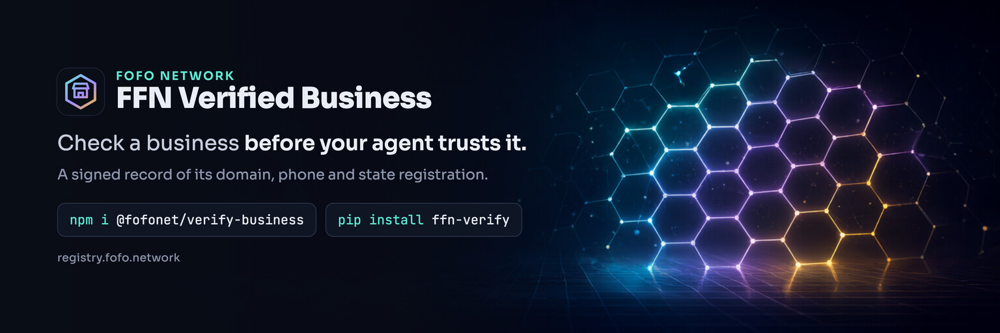

<p align="center">
  <a href="https://registry.fofo.network">
    
  </a>
</p>
<p align="center">
  <a href="https://github.com/Sweet-Papa-Technologies/ffn-verify/actions/workflows/ci.yml"></a>
  <a href="https://www.npmjs.com/package/@fofonet/verify-business"></a>
  <a href="https://www.npmjs.com/package/@fofonet/verify-business"></a>
  <a href="https://github.com/Sweet-Papa-Technologies/ffn-verify/blob/main/LICENSE"></a>
</p>

# @fofonet/verify-business

Verify a business against [FFN Verified Business](https://registry.fofo.network) before your agent or app trusts it. Give it a domain or a phone number; it fetches the business's signed record and checks all of it in your own process: the registry's signature against pinned keys, the business's own signature, the business's domain pointing back to the registry, and the current status of every fact.

Python: [`ffn-verify`](https://pypi.org/project/ffn-verify/). Both pass the same [test vectors](https://github.com/Sweet-Papa-Technologies/ffn-verify/tree/main/vectors).

```sh
npm install @fofonet/verify-business
```

Node 20 or later (it uses the built-in `fetch` and WebCrypto). ESM only, with TypeScript types included.

npm 12 and pnpm may say they blocked an install script from `cbor-extract`, which comes in through `@sd-jwt/sd-jwt-vc`. Leave it blocked: it only speeds up CBOR decoding, which this package doesn't use. This package has no install scripts of its own.

## Verify a business

```ts
import { verifyBusiness, FFN_BUSINESS_REGISTRY } from '@fofonet/verify-business';

const r = await verifyBusiness('sweetpapatechnologies.com', {
  registry: FFN_BUSINESS_REGISTRY,
  observed: { name: 'Sweet Papa Technologies', phone: '+1 510-497-0742' },
});

if (r.verified && r.observedMatches) {
  console.log(r.level, r.levelName); // 1 'Registered'
  console.log(r.summary);
} else if (r.verified) {
  console.log('Listed, but what you were told differs:', r.mismatches);
} else {
  console.log(r.failure?.code, r.failure?.message);
}
```

By phone: `verifyBusiness({ phone: '+15104970742' }, { registry: FFN_BUSINESS_REGISTRY })`. Pass exactly one of `domain` or `phone`. A phone query only counts the business's official channels when the registry confirmed that number.

### The result

| Field                   | Meaning                                                                                                                                                                                            |
| ----------------------- | -------------------------------------------------------------------------------------------------------------------------------------------------------------------------------------------------- |
| `verified`              | The record, its signatures and the domain binding check out, and the facts for at least Level 1 are current. Not a rating or a recommendation.                                                     |
| `observedMatches`       | `false` when anything in `observed` differs from the record (see `mismatches`). Always check it when you pass `observed`: a hacked site can swap in its own phone while the record stays verified. |
| `level`, `levelName`    | 0 none, 1 Registered, 2 Licensed and insured, 3 Owner verified.                                                                                                                                    |
| `business`              | The business's DID, record id, profile URL, the name it uses and the legal name the registry verified.                                                                                             |
| `facts`                 | Each fact (`businessIdentity`, `officialChannels`, `license`, `insurance`, `representative`) with `status`, `claims`, `checks` and a one-sentence `sentence`.                                      |
| `binding`               | Whether the business's `/.well-known/did.json` and `_ffn` DNS record point back to the registry (`confirmed`, `dns-only`, `missing`, `mismatch`, `unreachable`).                                   |
| `scope`                 | What the registry asserts about this business, and what it never asserts.                                                                                                                          |
| `summary`               | One paragraph you can show a person.                                                                                                                                                               |
| `failure`               | When `verified` is false: `{ code, message }`. Codes are listed in the [repository README](https://github.com/Sweet-Papa-Technologies/ffn-verify#what-a-result-means).                             |
| `warnings`, `checkedAt` | Anything worth noting, and when this check ran.                                                                                                                                                    |

A verified phone means the business controls that number when _you_ call it. It never means an incoming call or text from that number is from the business.

### Options

| Option              | Default                   | Meaning                                                                                                  |
| ------------------- | ------------------------- | -------------------------------------------------------------------------------------------------------- |
| `registry`          | required                  | The registry to trust. `FFN_BUSINESS_REGISTRY` is the production one, with its key thumbprints pinned.   |
| `observed`          | none                      | What your agent was told: `{ name?, phone?, address? }`. Compared with the record.                       |
| `timeoutMs`         | `10000`                   | Limit for each request, body included.                                                                   |
| `signal`            | none                      | An `AbortSignal` to cancel the whole check.                                                              |
| `fetch`             | global `fetch`            | Your own fetch, for example one that goes through an egress proxy. Size limits and timeouts still apply. |
| `dns`               | Cloudflare DNS over HTTPS | A TXT resolver, e.g. `dohResolver('google', fetch)` or your own.                                         |
| `resolver`, `store` | built in                  | A DID resolver and a cache for status lists, if you want to share them between calls.                    |

`lookupBusiness({ domain } | { phone }, { registry })` returns the record without the full check. Only the registry's signature is verified, so use `verifyBusiness` before trusting anything in it.

## Verify a presentation

When a business, or an agent acting for one, presents a credential to you:

```ts
import { verifyPresentation, FFN_BUSINESS_REGISTRY } from '@fofonet/verify-business';

const p = await verifyPresentation(
  {
    presentation, // the SD-JWT presentation you received
    nonce, // the nonce you issued
    audience: 'https://your-agent.example',
    issuers: [FFN_BUSINESS_REGISTRY.did!], // accept credentials from the registry
  },
  { registry: FFN_BUSINESS_REGISTRY },
);
if (p.verified) console.log(p.subject, p.vct, p.claims);
```

Delegations take `chain` (the parent delegations, nearest first) and `roots` (the DIDs a chain may start at). Credentials from an issuer you don't accept, and chains that don't start at a root you accept, fail before anything is fetched.

## Security

- **Pinned keys.** `FFN_BUSINESS_REGISTRY` carries the RFC 7638 thumbprints of the registry's signing key and its standby key. Every known FFN registry is pinned in every function; a custom registry passes `keyThumbprints`.
- **What it fetches:** the registry (the record and its status lists), the business's `did.json`, and its DNS TXT record over DNS over HTTPS. Everything is HTTPS-only, with no redirects, a size limit on every response and a time limit on every request.
- **What it refuses:** private, loopback and link-local addresses, `localhost`, `.local` and `.internal` names. Status lists must be signed by their host's own DID. If you run it inside a sensitive network, send its traffic through an egress proxy as well; that's the only full defense against DNS rebinding.

Found a problem? See the [security policy](https://github.com/Sweet-Papa-Technologies/ffn-verify/security/policy).

## Without a library

`GET https://registry.fofo.network/v1/verify?domain=…` returns the same result computed by the registry ([OpenAPI](https://registry.fofo.network/openapi.json)), and the registry runs an [MCP server](https://registry.fofo.network/agents#mcp). Both are simpler, but then you trust the registry's server instead of checking its signatures yourself.

## Links

[FFN Verified Business](https://registry.fofo.network) · [Guide for agents](https://registry.fofo.network/agents) · [llms.txt](https://registry.fofo.network/llms.txt) · [Source](https://github.com/Sweet-Papa-Technologies/ffn-verify) · [Changelog](https://github.com/Sweet-Papa-Technologies/ffn-verify/blob/main/CHANGELOG.md) · [FoFo Network](https://fofo.network)

Apache-2.0. Copyright 2026 Sweet Papa Technologies LLC.
